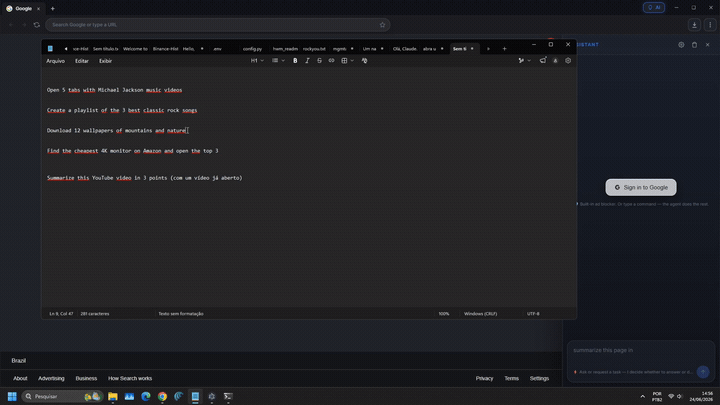

<p align="center">
  
</p>

<h1 align="center">Bah</h1>

<p align="center">
  <b>AI browser</b> — type in plain language, and the AI <b>autonomously</b> operates the web for you.<br/>
  <b>Perplexity Comet</b> style · open source · by <b>VilelaLab</b>.
</p>

<p align="center">
  🌐 <b>English</b> · <a href="README.pt-BR.md">Português</a>
</p>

<p align="center">
  <a href="https://github.com/alexvilelabah/bah-browser/releases"></a>
  <a href="https://github.com/alexvilelabah/bah-browser/releases/latest"></a>
</p>

> You give natural-language commands ("open gmail and delete the spam") and the AI operates the browser in your place — reading the screen, clicking with a real mouse, typing, and going until it's done.

> 🖼️ **Image generation works out of the box — no key.** For chat and the full autonomous agent, add a cheap key — **DeepSeek** (recommended), **Mistral** or **NVIDIA NIM** — or go 100% local + offline with **Ollama** (also free, no key).

<p align="center">
  <a href="https://www.electronjs.org"></a>
  <a href="https://react.dev"></a>
  <a href="https://www.typescriptlang.org"></a>
  <a href="https://vitejs.dev"></a>
</p>

<p align="center">
  <sub><b>Works with</b></sub><br/>
  <a href="https://deepseek.com"></a>
  <a href="https://mistral.ai"></a>
  <a href="https://build.nvidia.com"></a>
  <a href="https://ollama.com"></a>
</p>

## 💡 What people use Bah for

An open-source **AI browser agent** for the boring parts of the web: it reads the page, clicks, types,
uploads and waits like a person would, and **asks you before anything risky** (paying, deleting,
submitting, reading your files or clipboard). Runs with a cloud model or **100% local** (Ollama or
llama.cpp — tested with `Qwen3-VL-8B` on a 16 GB GPU).

| Ask it… | What Bah does | Status |
|---|---|---|
| *"Download the latest Ubuntu ISO"* · *"get the printer driver for my Mac"* | Finds the right file for **your** OS and CPU, clicks through EULAs and OS selectors, downloads in the background (any size, resumable), tells you the saved path; can verify checksums | ✅ tested end-to-end |
| *"Find a hotel in New York under $450 a night for next weekend"* | Searches booking sites, picks dates in the date picker, dismisses pop-ups (keeps coupon codes), compares prices | ✅ tested (Booking.com) |
| *"Compare prices for this product on Amazon and other stores"* · *"find a compatible charger for my laptop"* | Finds the exact part number on the maker's site, then checks several stores (new and used) and renders a comparison table | ✅ Amazon · 🧪 multi-store |
| *"Open my 2 recommended jobs"* · *"Apply to this job with my résumé"* | Reads your recommended jobs (saved ★ ones too), opens them one at a time, picks the best résumé from a folder **you** allow, fills the form **by code** — text fields and searchable drop-downs (Greenhouse, Workday) alike — from your 📝 application profile and saved answers, asks you once for anything left, and stops for your OK before submitting | 🧪 rehearsed on copies of real Indeed + Ashby pages (3/3) · live sites next |
| *"Who are the procurement managers at Acme?"* | People research on LinkedIn in **careful mode** — one page load per request, no automated clicking on sites whose terms forbid it | ✅ tested |
| *"Plan my Tokyo trip in Tokyo time"* | Shows sites in your destination's time zone and tells the agent when your VPN makes prices foreign | ✅ tested |
| *"Save this receipt as a PDF"* · *"screenshot the whole page"* · *"copy the total"* | Saves to Downloads / copies for you; reading your clipboard needs your permission | ✅ tested |
| Behind a **corporate proxy** (Blue Coat, PAC, SOCKS) with company TLS certificates | Uses the OS proxy and certificates for pages **and** Bah's own requests; proxy sign-in prompt | ✅ tested with an authenticating proxy |
| *"Build a grocery cart for a family of four"* · scheduled daily searches | Multi-item carts across grocers; tasks on a schedule with missed-run prompts | 🛠️ planned |

✅ tested end-to-end on the real site · 🧪 tested on purpose-built test pages · 🛠️ planned.
Want another workflow? Bah can **save what worked as a skill** — see [CONTRIBUTING-SKILLS.md](CONTRIBUTING-SKILLS.md).

## 🎬 Demo



▶️ **[Download the full video](https://github.com/alexvilelabah/bah-browser/raw/main/assets/demo.mp4)** — the agent searching and operating the web on its own. *(the GIF above is a preview; GitHub doesn't play embedded video in the README.)*

## 🚀 Quick Start (Plug & Play)

**🧑 I just want to use it (Windows):** [**grab the installer here**](https://github.com/alexvilelabah/bah-browser/releases/latest) → the `Bah-Setup-*.exe` file, double-click and install.

> 🏠 **Want it 100% local & free? No terminal needed.** Set up the AI right inside the browser: open the AI panel → 🏠 **Local AI** → type a model name → **Download**, and Bah pulls the Ollama model for you. (Prefer the cloud? A cheap DeepSeek key works too — and needs no GPU.)

> 🔄 **Auto-updates:** after installing, Bah checks for new versions, downloads them in the background and offers *"Restart now"* to apply — no reinstalling.

> ⚠️ Windows shows a blue *"protected your PC"* screen (the app isn't code-signed with a paid certificate yet). Click **More info → Run anyway** — normal for new open-source apps. (Later updates install without that warning.)

> 🛡️ **Windows blocks Bah and there's no "Run anyway" button?** If the installer — or an update — simply refuses to open, your PC has **Smart App Control** turned on. It's a stricter Windows 11 protection that blocks every app without a digital signature, and Microsoft offers [no way to allow a single app](https://support.microsoft.com/en-us/windows/security/threat-malware-protection/smart-app-control-frequently-asked-questions). Until Bah is code-signed, the only option is to turn it off: **Windows Security → App & browser control → Smart App Control settings → Off**. Your antivirus (Microsoft Defender) keeps running, new apps still get the usual *"protected your PC"* check, and recent Windows updates let you turn Smart App Control back on later without reinstalling Windows.

**🍎 macOS (new, starting with v1.8.12):** from the [same release page](https://github.com/alexvilelabah/bah-browser/releases/latest), get `Bah-*-arm64.dmg` (Apple Silicon: M1 and newer) or `Bah-*-x64.dmg` (Intel; check Apple menu → About This Mac). Open it and drag **Bah** into Applications. Needs macOS 13 (Ventura) or newer.

> ⚠️ The Mac version is new and isn't signed or notarized by Apple yet, so macOS refuses to open it, usually saying Bah *"is damaged and can't be opened"* (it isn't; that's just the missing Apple signature). Run `xattr -cr /Applications/Bah.app` in Terminal, then open Bah normally. There's no auto-update on macOS yet: to update, download the new `.dmg`, replace the app and run the `xattr` command again. Netflix, Prime Video and Disney+ don't play on the Mac version yet.

> 🍺 **Video/audio downloads on macOS use [Homebrew](https://brew.sh)'s tools:** `brew install yt-dlp deno ffmpeg` (or `brew bundle` in a clone of this repo, using the [`Brewfile`](Brewfile)). The Mac build doesn't download and run programs itself (an unsigned app running a freshly downloaded binary is what macOS distrusts most); Homebrew installs and updates them. Without ffmpeg, only audio downloads work, saved in the original format (usually M4A). Everything else works without them.

**👨‍💻 I want to hack on the code:** clone and run it — see [Running it](#running-it) below.

**🤖 An AI agent is installing Bah for you?** Point it at [INSTALL-FOR-AGENTS.md](INSTALL-FOR-AGENTS.md) — step-by-step, with a check after each step.

---

## What it does

- **Full browser** with tabs, navigation, URL bar, dark theme
- **AGENT panel** on the side: type a command → the AI decides step by step until it's done
- **Reads the page** (DOM, numbered interactive elements, and OCR) and acts through structured tools — it doesn't rely on "seeing" the screen. Works on pages that forbid scripts too (raw files on Hugging Face / GitHub): Bah reads them from its own isolated script world
- **AI**: image generation **works free out of the box** (no key). Chat and the full autonomous agent need a key — **DeepSeek** (cheap, recommended) — also **Mistral** / **NVIDIA NIM** — or **Ollama** (local/offline, free)
- **Assistant sessions on your tabs** — the first time you use the assistant on a tab it gets a session: a coloured chip with a short name ("Job hunt", "Groceries") on the tab strip, like a Chrome tab group. Tabs in a session share one conversation — tabs the agent opens, and links you open from a session tab, join it; right-click a tab to add it to a session or take it out; click the chip to rename or recolour
- **Scheduled tasks** — "every weekday at 8am check my Indeed recommendations" or ⋮ → ⏰ Scheduled tasks: runs while Bah is open, each in its own tab; a time missed while Bah was closed is offered when it opens; anything that needs your OK (send, buy, submit, sign in) waits for you with a notification
- **One memory per session, sized for small local models** — the agent and the chat share the session's conversation (requests, answers, task summaries, facts, 📌 pinned items) within a fixed token budget, so the page is never crowded out. When it fills up, older turns are summarized **visibly** in the panel (expand to read the summary; `/compact` on demand). A **context meter** next to the model name shows `context 6.1k / 16k · thread 2.3k` and, tapped, what took the room
- **Conversations survive a restart** with ⋮ → When Bah opens → "Continue where you left off", and **🕘 Chat history** (⋮) lists past sessions — open one read-only or **Resume** it, reopening its tabs. Stored encrypted on this computer, never for incognito tabs, cleared with "Clear browsing data"
- **Understands follow-ups** — "did you click it?" is answered from a log of what the agent just did (not a web search); "one window was opened, but not the second" sends the agent back to finish; "it" / "that one" in a new request means the last thing the agent acted on
- **Goes straight to sites you name** — "browse to linkedin, find a job…" opens linkedin.com right away instead of searching for it first. Only a short, checked list of well-known sites is used; an unknown name is searched, never guessed
- **"Summarize my open tabs"** — one line per tab plus an overall summary, each with a link to switch to it. Asks before reading your tabs (or follows your always/never choice), skips incognito tabs and internal pages, and leaves sleeping tabs asleep unless you ask
- **Natural-language routing** — commands that start with an action ("search for…", "find…", "browse to…", "apply…") go to the agent; questions get an answer. Typos like "open 2 windos … a different video in each" still open 2 videos
- **One-shot skills**: open N videos at once, jump to the exact moment a phrase is spoken across several videos, **chat about a YouTube video using its transcript**, compare prices, fetch news — deterministic shortcuts that cost zero tokens
- **UI in English by default**, with **Português** and **Español** available in Settings — the AI replies in your chosen language
- **Full adblock** (EasyList + EasyPrivacy) with automatic bypass for sites that break (YouTube, Twitch)
- **Safe Browsing** (URLhaus malicious-hosts list, updated daily)
- **Real mouse clicks** via Chromium `sendInputEvent` (not synthetic events — goes through React, Vue, Angular without being ignored)
- **Honest, consistent browser identity** — current Chrome user agent, client hints and languages set inside the engine (one source, no JavaScript patching), so sites see a normal Chrome and don't wrongly block it. It does not try to evade bot detection; sites that forbid automation get **careful mode**
- **Navigation skills** — short `SKILL.md` recipes (pop-ups, date pickers, autocomplete, EULAs, OS selectors, downloads, shopping, travel, people search, job applications, card lists, sign-in) chosen per step; save your own after a task that worked
- **Safety first** — confirms payments/deletions/submits; site permissions (location, camera, microphone, clipboard) are **blocked until you allow them**; uploads only use files *you* pick or a folder *you* allow for the session; page dialogs go through Bah's own box
- **Corporate networks** — system/manual/PAC/SOCKS proxies with sign-in, OS root certificates, WebRTC leak protection, VPN-aware region and a "time zone for sites" setting
- **Comet-style visual overlay** — pulsing border, scan line, click ripple, status label

---

## Stack

| Layer | Tech |
|---|---|
| Browser shell | **Electron 44** + Chromium |
| UI | **React 19** + **TypeScript** + Vite |
| AI (cloud) | **DeepSeek** (recommended) · **Mistral** · **NVIDIA NIM** |
| AI (local) | **Ollama** |
| Adblock | `@ghostery/adblocker-electron` |
| Webview | `<webview>` tag with persistent partition |

---

## The agent's ReAct loop (core)

```
USER → "open gmail and delete the spam"
        │
        ▼
┌───────────────────────────────────────────────┐
│  for step in 1..25:                           │
│    1. observePage(webview)                    │
│       → { url, title, interactive_elements }  │
│    2. captureScreenshot()                     │
│    3. AI decides ONE action:                  │
│       { action: { type, ...params } }         │
│    4. execute action via REAL OS input        │
│    5. wait, re-observe, self-evaluate         │
│    6. if action == 'done' → return            │
└───────────────────────────────────────────────┘
```

### Tools the AI can call

The agent answers with one JSON action per step (or a short batch). Command parity with
[agent-browser](https://agent-browser.dev/commands), adapted to a human-in-the-loop desktop browser.

| Group | Actions |
|---|---|
| **Click & type** | `click_ref` · `fill_ref` · `click_text` · `click_role` (role + name + nth) · `click_at` · `fill` (by label/placeholder) · `type` · `insert_text` · `press` (combos like `Control+Enter`) · `keydown` / `keyup` · `hover` · `dblclick` · `focus` · `drag` · `check` / `uncheck` · `select_option` |
| **Read the page** | element list (with `frame="…"` for iframe content and `disabled` marks) · `extract_text` · `find` · `look_at` (zoomed crop) · `get` (value, checked, enabled, visible…) |
| **Navigate & wait** | `navigate` · `back` / `forward` / `reload` · `scroll` · `new_tab` / `switch_tab` / `close_tab` · `wait` (`ms`, or until `text` / `gone` / `url` / `load: "networkidle"`) |
| **Search** | `web_search` (Google → Bing → DuckDuckGo → Yahoo → Perplexity, skipping engines that block) · `history_search` (asks permission) |
| **Files** | `upload` (you pick in the OS dialog) · `list_files` / `read_file` / `upload { file }` (a folder you allow for the session) · `download` + `list/cancel/pause/resume/retry_download` · `save_pdf` · `screenshot { full }` |
| **Dialogs & clipboard** | `dialog { accept }` (answer the next alert/confirm) · `clipboard { write }` · `clipboard { read }` (asks permission) |
| **Plan & finish** | `plan` · `store` · `suggest_time_zone` (you confirm) · `render_view` (comparison table) · `done(reason, success)` |

Clicks happen through `webContents.sendInputEvent` in the main process — a **real** Chromium mouse event, not a synthetic one, so React/Vue/anti-bot sites respond normally. The AI prefers the **DOM-first** path (`click_ref`), falling back to text and then coordinates.

---

## Running it

```bash
git clone https://github.com/alexvilelabah/bah-browser.git
cd bah-browser
npm install
npm run build
npm start        # or: npx electron .
```

Windows shortcut: double-click `Abrir-Bah.bat`.

### Setting up the AI

1. Open the browser, click the **AI** button in the address bar.
2. Gear icon → pick a provider.
3. Pick **DeepSeek**, **Mistral** or **NVIDIA NIM** and paste that provider's key (DeepSeek's is very cheap) → Save. Image generation works with no key either way; chat and the agent need this (or local Ollama, next step).
4. **Local (optional, free/offline):** install [Ollama](https://ollama.com) and **keep it running** (it lives in the tray and serves models at `127.0.0.1:11434`). Then download a model from inside Bah (☁️/🏠 → 🏠 Local AI → type a name → **Download**) or in a terminal (e.g. `ollama pull qwen3:14b`). Local works offline, but the cloud (DeepSeek) is more reliable.
5. **Local via llama.cpp (tested setup):** Bah also talks to any OpenAI-compatible server. We test the agent against [llama.cpp](https://github.com/ggml-org/llama.cpp)'s `llama-server` running **`Qwen3-VL-8B-Instruct-Q4_K_M.gguf`** (from [`unsloth/Qwen3-VL-8B-Instruct-GGUF`](https://huggingface.co/unsloth/Qwen3-VL-8B-Instruct-GGUF), with its vision projector) on a 16 GB NVIDIA GPU — it fits fully in VRAM and is fast enough for step-by-step browsing:
   ```bash
   llama-server -hf unsloth/Qwen3-VL-8B-Instruct-GGUF:Q4_K_M -c 32768 -ngl 99 --host 0.0.0.0 --port 8080
   ```
   In Bah: gear icon → 🏠 Local AI → OpenAI-compatible endpoint `http://<server>:8080/v1`. With this model the agent reliably handles multi-page download tasks — e.g. *"download the latest ubuntu iso"* (finds the release index, starts the download, waits for it and reports the saved path; ISO verified against the published SHA256). Use a vision-capable model (the `-VL-` variants): the agent reads the screenshot as well as the page's element list.

### Corporate networks (proxy, company certificates)

Bah follows the **operating system's proxy settings** by default, like Chrome — including automatic
detection (WPAD) and PAC scripts set by IT. To set one by hand: menu ⋮ → **🌐 Network & proxy**:
**System** (default) · **Manual** (`proxy.corp:8080` for HTTP+HTTPS, or `socks5://127.0.0.1:1080` for a
SOCKS proxy / `ssh -D` tunnel) · **PAC** (script URL) · **Direct**, plus a bypass list and a
**Test connection** button. `HTTPS_PROXY` / `HTTP_PROXY` / `NO_PROXY` pre-configure it when nothing is saved.

- **Proxy sign-in (HTTP 407, e.g. Blue Coat):** Bah asks for the username and password in its own box;
  *Remember* stores them encrypted with the OS keychain (`safeStorage`). They never reach the agent or the model.
- **Everything uses the same route:** pages, sign-in windows, Bah's own requests (AI calls, updates,
  search) and the agent's downloads all go through the browser engine's network stack, so one proxy
  setting (and one sign-in) covers them.
- **Company root certificates (TLS inspection):** Chromium already trusts the OS certificate store.
  Electron's Node does not, so Bah reads the OS store at startup (macOS keychains, Windows `Root`/`CA`
  stores, Linux CA bundle) and adds those roots to Node's defaults — downloads in the worker thread work
  behind a TLS-inspecting proxy too.
- **WebRTC IP leak:** while a proxy is in use, WebRTC may only use the proxy (`disable_non_proxied_udp`), so a
  page cannot learn your real IP through it. Without a proxy (or with a VPN app, which is OS-level) Chrome's
  default applies. Chromium cannot sign in to SOCKS5 proxies (username/password); SOCKS5 without a password works.

### Region & time (VPN, travel)

Menu ⋮ → **🌍 Region & time**:
- **Network location:** with a VPN or proxy, sites show the prices, currency and stock of the country your
  connection exits in. In **Auto** (default) Bah checks that country with one request to Cloudflare's
  `cdn-cgi/trace` when a task starts (cached 10 min, rechecked when the proxy changes) and tells the agent,
  so it does not call foreign prices "local". Searches use that country (`gl=` / `cc=`). On a shopping or
  travel task, if the network country differs from your computer's, Bah asks once which to prefer.
  **My computer's region** or **a specific country** never checks the network.
- **Time zone for sites:** your computer's (default), a chosen zone for planning a trip or a flight, or
  **UTC** (hides your real zone from page scripts). Set in the engine like DevTools' override; a 🕐 chip in
  the address bar shows it; it goes back to your computer's zone on restart unless you tick *Keep*. The
  agent can only *suggest* a zone (`suggest_time_zone`) — you confirm. Signed-in calendars usually follow
  the time zone in your account settings, not the browser's.

---

## Safety & limits

The agent runs with full browser privileges, so it's worth being clear about what it does and doesn't do:

> ⚖️ **You're in control — and responsible.** Bah acts in your real session, on your account. Use it within each site's terms and the law. Sensitive actions (paying, buying, deleting, entering card data) always ask for your confirmation first.

> 🔍 **Audit it yourself.** The full threat model, a verify-it-yourself checklist (each protection → the exact file), what leaves your machine, and an honest list of accepted tradeoffs all live in **[SECURITY.md](SECURITY.md)**. A map of the codebase — every file, the live agent loop, the build — is in **[ARCHITECTURE.md](ARCHITECTURE.md)**. The whole of `src/` is ~30 files.

- 🔓 **It's your real session.** The browser uses a persistent partition (`persist:browser`), so cookies and logins are saved. If you're logged into Gmail in Bah, so is the agent. **The AI can access anything you could access manually.** Don't log into accounts you wouldn't trust an assistant with.

- 🛡️ **Safety brake on sensitive actions.** Before **paying, buying, deleting, entering card data, or sending a job application**, the agent **pauses and asks for your confirmation** — and this works on *every* path (model clicks, coordinate clicks, Enter on a checkout page, learned shortcuts, and repeated automations). It never does those silently.

- 🛑 **Stop means stop.** The ■ Stop button cancels immediately, even mid model-call or mid-loop; a late response won't "resurrect" a cancelled task.

- 🎯 **No fake success.** After a fill/type the agent checks the field actually holds the value; if an action had no real effect it switches strategy instead of reporting success.

- 🙋 **Asks for help when blocked.** On a CAPTCHA, login wall, or paywall it **stops and asks you to step in**, then resumes — it doesn't flail.

- 🔐 **Signs in only with you.** When a task needs your account ("my list", "my saved jobs", orders, inbox) the agent may click the site's **Sign in** button once; at the login form Bah **pauses** — you sign in (click the username field to pick a login saved in Bah's password manager, or type it) and press Continue. The agent never types or sees a password and never guesses a username. Bah tracks whether you're **signed in or out per site** and tells the agent each step, so it doesn't re-click Sign in or assume pages it can't see.

- 🔢 **25-step cap per command.** If a task doesn't finish in 25 actions, the agent stops on its own.

- 🧩 **Compatibility, not evasion.** We present as a standard, current Chrome (user agent, client hints and languages set consistently inside the engine — no page-script patching) only to avoid being wrongly blocked. Sites whose terms forbid automation (e.g. LinkedIn) get **careful mode**: one page load per request, no automated clicking — if the agent tries anyway, Bah stops the task and tells you what to do by hand (sign in yourself; open the job and click Apply, then let Bah continue on the company's own application site). We do **not** solve image CAPTCHAs or dodge rate-limits. By default the agent stops and asks you on any human-verification page; an **opt-in** menu switch (☑️ *Agent may click captcha checkboxes*, off by default) lets it click a simple "I'm not a robot" / "Verify you are human" checkbox once — the captcha service still decides, and anything more (image puzzles) goes back to you. Respect each site's terms.

- **🔑 Google login — use the "Sign in to Google" button.** Google blocks login *inside* embedded browsers (Electron/webview). Bah handles it the right way: click **🔑 Sign in to Google** → it opens the login in your **real Chrome/Edge** (where Google trusts it), you sign in, and Bah **detects it automatically**, imports the session (cookies via CDP) and closes the login window. Do it **once** and you stay logged in.

- 📥 **Downloads have no type or size limit.** Any file type can be downloaded (installers included), streamed straight to disk. **Torrents:** by default `.torrent` files just download like any other file and `magnet:` links open in your system's torrent app; turn on **🧲 Built-in torrent client** in the menu to open them in Bah's own torrent card instead. Details in [ARCHITECTURE.md](ARCHITECTURE.md#downloads--torrents).

- 🚫 **Adblock pauses on known sites.** YouTube and Twitch get automatic bypass so their player isn't blocked by anti-adblock. Everywhere else adblock stays on.

**Not implemented yet** (but would be nice): a "preview the plan, then approve" mode before running, a per-tab sandbox, and click rate-limiting to avoid aggressive bot-like behavior.

---

## Comparison with other agents

|  | **Bah** | Comet | Browser-Use |
|---|---|---|---|
| Open source | ✅ | ❌ | ✅ |
| 100% local option (Ollama) | ✅ | ❌ | ✅ |
| Runs at home | ✅ | ❌ | ❌ (lib only) |
| Cloud **or** local AI | ✅ | ❌ (cloud only) | ✅ |
| Real clicks (not synthetic) | ✅ | ✅ | ✅ |
| Full UI | ✅ | ✅ | ❌ |
| Adblock + Safe Browsing | ✅ | ✅ | ❌ |
| Confirmation before sensitive actions | ✅ | ⚠️ | ❌ |

> ℹ️ The **tested and recommended** AI path is **DeepSeek (cloud)**; local (Ollama) also works but is **less validated**.

---

## License

**MIT** — see [LICENSE](LICENSE).

In short:

- Free and open source.
- You may use, modify, redistribute, and use it commercially.
- Keep the copyright and license notice.
- No warranty. Provided "as is".

---

## Contact

- 📧 **Email**: **alexmachadovilela@gmail.com**
- 🐦 **X / Twitter**: [@alexvilelaba](https://x.com/alexvilelaba)
- 🐛 **Bugs / ideas**: [open an issue](https://github.com/alexvilelabah/bah-browser/issues)

Made with 🧉 by **Alex Vilela** — **VilelaLab**.
