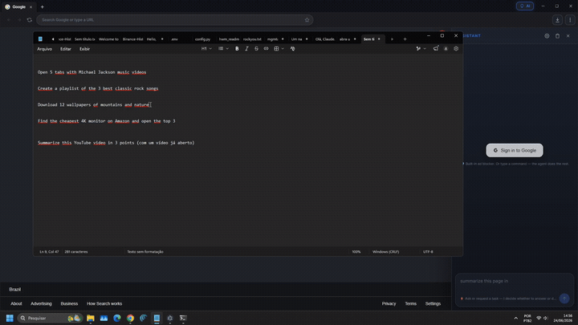

<p align="center">
  
</p>

<h1 align="center">Bah</h1>

<p align="center">
  <b>Navegador com IA</b> — você fala em português, ele opera a web pra você.<br/>
  Estilo <b>Perplexity Comet</b> · open source · por <b>VilelaLab</b>.
</p>

<p align="center">
  <a href="README.md">English</a> · 🌐 <b>Português</b>
</p>

<p align="center">
  <a href="https://github.com/alexvilelabah/bah-browser/releases"></a>
  <a href="https://github.com/alexvilelabah/bah-browser/releases/latest"></a>
</p>

> Você dá comandos em linguagem natural ("abre o gmail e apaga os spams") e a IA opera o navegador no seu lugar — vendo a tela, clicando com mouse real, digitando e seguindo até concluir.

> 🖼️ **Gerar imagem funciona de cara — sem chave.** Pra conversar e pro agente autônomo completo, adicione uma chave barata — **DeepSeek** (recomendado), **Mistral** ou **NVIDIA NIM** — ou vá 100% local + offline com **Ollama** (também grátis, sem chave).

<p align="center">
  <a href="https://www.electronjs.org"></a>
  <a href="https://react.dev"></a>
  <a href="https://www.typescriptlang.org"></a>
  <a href="https://vitejs.dev"></a>
</p>

<p align="center">
  <sub><b>Funciona com</b></sub><br/>
  <a href="https://deepseek.com"></a>
  <a href="https://mistral.ai"></a>
  <a href="https://build.nvidia.com"></a>
  <a href="https://ollama.com"></a>
</p>

## 💡 Pra que as pessoas usam o Bah

Um **agente de navegador com IA**, open source, pras partes chatas da web: lê a página, clica, digita,
envia arquivos e espera como uma pessoa faria, e **pergunta antes de qualquer coisa arriscada** (pagar,
excluir, enviar formulário, ler seus arquivos ou a área de transferência). Funciona com modelo na nuvem
ou **100% local** (Ollama ou llama.cpp — testado com `Qwen3-VL-8B` numa GPU de 16 GB).

| Peça… | O que o Bah faz | Status |
|---|---|---|
| *"Baixe a ISO mais recente do Ubuntu"* · *"o driver da impressora pro meu Mac"* | Acha o arquivo certo pro **seu** SO e CPU, passa por EULA e seletor de SO, baixa em segundo plano (qualquer tamanho) e informa o caminho; confere checksum | ✅ testado de ponta a ponta |
| *"Baixe a última versão do Steam / software da impressora HP / Office / SolidWorks / Altium / Photoshop pra este computador"* | Vai à página **oficial** do fabricante (marca agregadores de "free download"), pega a versão do seu SO **e CPU** (Intel × Apple Silicon, x64 × ARM64), avisa se o arquivo é do SO/CPU errado e **para na parede de login** pra você decidir (nunca digita senha nem cria conta). Nunca abre o instalador | 🧪 páginas de teste (detecção automática, lista SO/CPU, modelo de impressora, modal, login). Ao vivo, Qwen3-VL-8B local, Mac Intel: ✅ Steam (`steam.dmg`) · ✅ Altium (parou no login) · ❌ HP 9015e, Office, SolidWorks, Photoshop (chegou à página oficial, não escolheu versão) |
| *"Hotel em Nova York até US$ 450 a diária no próximo fim de semana"* | Busca em sites de reserva, escolhe datas no calendário, fecha popups (guarda cupons) e compara preços | ✅ testado (Booking.com) |
| *"Compare preços deste produto na Amazon e em outras lojas"* · *"carregador compatível com meu notebook"* | Acha o número da peça no site do fabricante e confere várias lojas (novo e usado), com tabela comparativa | ✅ Amazon · 🧪 várias lojas |
| *"Abra minhas 2 vagas recomendadas"* · *"Candidate-se a esta vaga com meu currículo"* | Lê suas vagas recomendadas (inclusive as salvas ★), abre uma por vez, escolhe o melhor currículo de uma pasta que **você** libera, preenche o formulário **por código** — campos de texto e listas suspensas com busca (Greenhouse, Workday) — com seu 📝 perfil de candidatura e respostas salvas, pergunta uma vez o que faltar e para pro seu OK antes de enviar | 🧪 ensaiado em cópias de páginas reais do Indeed + Ashby (3/3) · sites ao vivo a seguir |
| *"Põe leite, ovos, bananas e uma dúzia de bagels no meu carrinho do Walmart"* | Busca item por item, escolhe pelo que você disse (marca, tamanho, orgânico) ou por um padrão sensato da marca da loja e diz por quê, acerta as quantidades (uma dúzia de bagels = 2 pacotes de 6), pergunta antes de substituir algo esgotado e antes de escolher retirada/entrega ou loja, confere o carrinho, mostra uma tabela — e **nunca fecha o pedido** (o freio pergunta antes de Checkout / Place order / Reserve time slot) | 🧪 ensaiado em cópias locais de lojas com o modelo local 8B: cópia do Walmart 3/3 carrinhos certos e nunca fechou o pedido (2/3 também conferiram o carrinho e relataram) · cópias do Whole Foods e da Target 0/1 · lojas ao vivo ainda não |
| *"Abra um chamado na Apple sobre a bateria do meu MacBook"* · *"Pergunte na comunidade da Dell por que o ventilador do meu XPS faz barulho"* | Vai só ao site **oficial** de suporte ou à comunidade do fabricante (e recusa ir pra outros sites), escolhe produto → assunto → formas de contato, procura na comunidade antes de redigir um post e **preenche o chamado por código com o que já se sabe** — o seu pedido e as respostas seguintes, o produto e o serial que você deu, um tópico parecido que ele viu — redigido pelo seu modelo com a regra "só estes fatos" (o que ele acrescentar, como o ano do modelo, é recusado e o Bah volta às suas palavras num modelo fixo), mais o assunto e os campos de contato do 📝 perfil; um cartão pede pra você conferir na aba, mudar o que quiser e apertar Continuar. Nunca senha, nunca cria conta. Página do fabricante que não carrega (Access Denied / 403, não encontrada, em branco) → ele busca essa página na web e só abre resultado do domínio do próprio fabricante; continuou bloqueada → para e diz. Tarefa que termina fora do site do fabricante é relatada como não feita; no login o Bah pausa pra você, e o **Enviar / Postar** final mostra antes o texto exato | 🧪 modelo local 8B (Qwen3-VL-8B) em cópias de treino, com o formulário preenchido por código: chamados enviados pelo cartão: Dell 3/3, Apple 2/5 (os que faltaram nem chegaram ao formulário e terminaram como falha); posts 6/6 (um como resposta no tópico parecido); todo formulário alcançado teve a descrição preenchida e o cartão de revisão; nenhuma frase inventada no que foi enviado; todo login alcançado pausou, todo envio perguntou, nenhuma senha digitada · ao vivo: a aba "Contact Support" da Dell responde Access Denied ao Bah — o agente agora busca a página em vez de sair da Dell (conferido com páginas sintéticas, não ao vivo) |
| *"Quem são os gerentes de compras da Acme?"* | Pesquisa de pessoas no LinkedIn em **modo cuidadoso** — uma página por pedido, sem clique automático | ✅ testado |
| *"Planeje minha viagem a Tóquio no horário de Tóquio"* | Mostra os sites no fuso do destino e avisa o agente quando a VPN deixa os preços estrangeiros | ✅ testado |
| *"Salve este recibo em PDF"* · *"print da página inteira"* · *"copie o total"* | Salva em Downloads / copia pra você; ler a área de transferência pede sua permissão | ✅ testado |
| Atrás de **proxy corporativo** (Blue Coat, PAC, SOCKS) com certificados da empresa | Usa o proxy e os certificados do SO nas páginas **e** nas requisições do próprio Bah; caixa de login do proxy | ✅ testado com proxy com autenticação |
| *"Monte um carrinho de mercado pra família de quatro"* · buscas agendadas | Carrinhos com vários itens em mercados; tarefas agendadas com aviso de execução perdida | 🛠️ planejado |

✅ testado de ponta a ponta no site real · 🧪 testado em páginas de teste · 🛠️ planejado.
Quer outro fluxo? O Bah pode **salvar o que funcionou como skill** — ver [CONTRIBUTING-SKILLS.md](CONTRIBUTING-SKILLS.md).

## 🎬 Demonstração



▶️ **[Baixar o vídeo completo](https://github.com/alexvilelabah/bah-browser/raw/main/assets/demo.mp4)** — o agente pesquisando e operando a web sozinho. *(o GIF acima é a prévia; o GitHub não toca vídeo embutido no README.)*

## 📥 Baixar

**🧑 Só quero usar (Windows):** [**baixe o instalador aqui**](https://github.com/alexvilelabah/bah-browser/releases/latest) → arquivo `Bah-Setup-*.exe`, clique 2× e instale.

> 🔄 **Atualiza sozinho:** depois de instalar, o Bah verifica novas versões, baixa em segundo plano e oferece *"Reiniciar agora"* pra aplicar — sem reinstalar nada.

> ⚠️ O Windows mostra uma tela azul *"protegeu seu PC"* (o app ainda não tem assinatura digital paga). Clique em **Mais informações → Executar assim mesmo** — é normal em apps novos de código aberto. (As atualizações seguintes entram sem esse aviso.)

**🍎 macOS (novo, a partir da v1.8.12):** na [mesma página de download](https://github.com/alexvilelabah/bah-browser/releases/latest), baixe o `Bah-*-arm64.dmg` se o seu Mac for Apple Silicon (M1 em diante) ou o `Bah-*-x64.dmg` se for Intel (dá pra ver no menu Apple → Sobre Este Mac). Abra o arquivo e arraste o **Bah** pra pasta Aplicativos. Precisa do macOS 13 (Ventura) ou mais novo.

> ⚠️ A versão de Mac é nova e ainda não tem assinatura nem notarização da Apple, então, na primeira vez que você abrir, o macOS geralmente diz que o Bah *"está danificado e não pode ser aberto"* — ele não está danificado, é só a falta da assinatura. Abra o Terminal, rode `xattr -cr /Applications/Bah.app` e depois abra o Bah normalmente. Ainda não tem atualização automática no Mac: pra atualizar, baixe o `.dmg` novo, substitua o app e rode o comando `xattr` de novo. Netflix, Prime Video e Disney+ ainda não tocam na versão de Mac.

> 🍺 **Baixar vídeo/áudio no macOS usa as ferramentas do [Homebrew](https://brew.sh):** `brew install yt-dlp deno ffmpeg` (ou `brew bundle` num clone deste repositório, com o [`Brewfile`](Brewfile)). O build de Mac não baixa nem roda programas sozinho (app sem assinatura rodando binário recém-baixado é o que o macOS mais desconfia); o Homebrew instala e atualiza. Sem o ffmpeg, só o download de áudio funciona, no formato original (geralmente M4A). O resto funciona sem eles.

**👨‍💻 Quero mexer no código:** clone e rode — veja [Como rodar](#como-rodar) abaixo.

---

## O que ele faz

- **Navegador completo** com abas, navegação, URL, tema dark
- **Painel AGENTE** lateral: digita um comando → a IA decide passo a passo até concluir
- **Lê a página** (DOM, elementos interativos numerados e OCR) e age por ferramentas estruturadas — sem depender de "enxergar" a tela Funciona também em páginas que proíbem scripts (arquivos crus do Hugging Face / GitHub): o Bah lê pelo próprio mundo isolado de scripts
- **IA**: gerar imagem **funciona grátis de cara** (sem chave). Conversar e o agente autônomo completo precisam de chave — **DeepSeek** (barato, recomendado) — também **Mistral** / **NVIDIA NIM** — ou **Ollama** (local/offline, grátis)
- **Sessões do assistente nas suas abas** — na 1ª vez que você usa o assistente numa aba ela ganha uma sessão: um chip colorido com um nome curto ("Job hunt", "Groceries") na barra de abas, como um grupo de abas do Chrome. As abas de uma sessão dividem a mesma conversa — as que o agente abre, e os links que você abre a partir de uma aba da sessão, entram nela; botão direito na aba adiciona a uma sessão ou tira dela; clique no chip para renomear ou mudar a cor
- **Tarefas agendadas** — "dias úteis às 8h veja minhas vagas no Indeed" ou ⋮ → ⏰ Tarefas agendadas: rodam com o Bah aberto, cada uma na sua aba; um horário perdido com o Bah fechado é oferecido quando ele abre; o que precisa do seu OK (enviar, comprar, mandar formulário, entrar na conta) espera você, com notificação
- **Uma memória por sessão, do tamanho de um modelo local pequeno** — o agente e o chat dividem a conversa da sessão (pedidos, respostas, resumos das tarefas, fatos, itens 📌 fixados) dentro de um orçamento fixo de tokens, então a página nunca perde espaço. Quando enche, os itens mais antigos viram resumo **à vista** no painel (abre pra ler o resumo; `/compact` quando quiser). Um **medidor de contexto** ao lado do nome do modelo mostra `contexto 6.1k / 16k · conversa 2.3k` e, num toque, o que ocupou a janela
- **A conversa volta depois de reiniciar** com ⋮ → Ao abrir o Bah → "Continuar de onde parou", e o **🕘 Histórico de conversas** (⋮) lista as sessões passadas — abra só pra ler ou **Retome**, reabrindo as abas dela. Guardado cifrado neste computador, nunca das abas anônimas, apagado no "Limpar dados de navegação"
- **Economia de memória** — igual à do Chrome: abas que você não usa há um tempo (⋮ → 💤: Moderada 2 h, Equilibrada 30 min, Máxima 10 min) liberam a memória e recarregam ao clicar. Nunca abas tocando áudio/vídeo, usando câmera, microfone ou a tela, baixando, com formulário pela metade, fixadas, com notificações ou dispositivo conectado, na sua lista "manter estes sites sempre ativos", ou com tarefa da IA rodando ou esperando você
- **Entende continuação** — "você clicou?" é respondido com o registro do que o agente acabou de fazer (não com busca na web); "abriu uma janela, mas não a segunda" manda o agente terminar o que faltou; "isso" / "essa" num pedido novo é a última coisa em que o agente agiu
- **Vai direto ao site que você cita** — "browse to linkedin, find a job…" abre o linkedin.com na hora, sem pesquisar antes. Só vale pra uma lista curta e conferida de sites conhecidos; nome desconhecido é pesquisado, nunca chutado
- **"Resuma minhas abas abertas"** — uma linha por aba e um resumo geral, cada uma com link pra ir até ela. Pergunta antes de ler suas abas (ou segue sua escolha sempre/nunca), pula abas anônimas e páginas internas, e deixa as abas dormindo quietas a menos que você peça
- **Roteamento em linguagem natural** — pedidos que começam com uma ação ("procure…", "pesquise…", "abra…", "candidate-se…") vão pro agente; perguntas ganham resposta. Erros de digitação como "open 2 windos … a different video in each" ainda abrem 2 vídeos
- **Roteador local opcional** — baixe uma vez um modelo pequeno (Qwen2.5-1.5B, 1,1 GB, Apache-2.0; ele pergunta antes) e cada mensagem é rotulada no seu próprio computador antes de chegar na IA: tarefa, pergunta sobre a página, pergunta pra web, conversa, pergunta sobre a última tarefa ou "deu errado, conserta". Entende erro de digitação ("search for a set of new golf blubs"); seu texto nunca sai do computador; sem ele as regras de palavras decidem como antes. Em pedidos de "achar/baixar" sobre uma obra nomeada ele também deixa o pedido preciso antes da IA grande começar ("clipes de top gun com tom cruise" → "…o filme Top Gun de 1986…"), mostrado como **🔎 Entendido como: …**; a IA grande recebe os dois textos e o seu manda. Coleções de mídia ("todos os clipes do filme X") são então buscadas faixa por faixa como título + artista + ano
- **Atalhos de uma tacada**: abrir N vídeos de uma vez, pular pro momento exato em que uma frase é dita em vários vídeos, **conversar sobre um vídeo do YouTube usando a transcrição**, comparar preços, buscar notícias — atalhos determinísticos que gastam zero tokens
- **UI em inglês por padrão**, com **Português** e **Español** disponíveis nas Configurações — a IA responde no idioma que você escolher
- **Adblock** completo (EasyList + EasyPrivacy) com bypass automático em sites que quebram (YouTube, Twitch)
- **Safe Browsing** (lista de hosts maliciosos URLhaus, atualiza diariamente)
- **Cliques reais de mouse** via Chromium `sendInputEvent` (não synthetic — passa por React, Vue, Angular sem ser ignorado)
- **Identidade honesta e consistente** — user agent, client hints e idiomas do Chrome atual definidos dentro do motor (uma fonte só, sem remendo em JavaScript), pra os sites verem um Chrome normal e não bloquearem por engano. Não tenta driblar detecção de robô; sites que proíbem automação ficam em **modo cuidadoso**
- **Skills de navegação** — receitas curtas `SKILL.md` (popups, calendários, autocomplete, EULAs, seletor de SO, downloads, compras, viagens, pesquisa de pessoas, candidaturas a vagas, listas de cartões, login) escolhidas a cada passo; salve as suas depois de uma tarefa que deu certo
- **Segurança primeiro** — confirma pagamento/exclusão/envio; permissões de site (localização, câmera, microfone, área de transferência) ficam **bloqueadas até você liberar**; upload só usa arquivo que *você* escolhe ou de uma pasta que *você* libera na sessão; diálogos das páginas passam pela caixa do próprio Bah
- **Redes corporativas** — proxy do sistema/manual/PAC/SOCKS com login, certificados-raiz do SO, proteção contra vazamento por WebRTC, região ciente de VPN e "fuso dos sites"
- **Overlay visual** estilo Comet — borda pulsante, scan line, ripple no clique, label de status

---

## Stack

| Camada | Tecnologia |
|---|---|
| Shell do navegador | **Electron 44** + Chromium |
| UI | **React 19** + **TypeScript** + Vite |
| IA (nuvem) | **DeepSeek** (recomendado) · **Mistral** · **NVIDIA NIM** |
| IA (local) | **Ollama** |
| Adblock | `@ghostery/adblocker-electron` |
| Webview | Tag `<webview>` com partition persistente |

---

## Loop ReAct do agente (núcleo)

```
USUÁRIO → "abre o gmail e apaga os spams"
        │
        ▼
┌───────────────────────────────────────────────┐
│  para cada passo em 1..25:                     │
│    1. observePage(webview)                     │
│       → { url, title, interactive_elements }   │
│    2. captureScreenshot()                      │
│    3. a IA decide UMA ação:                    │
│       { action: { type, ...params } }          │
│    4. executa via INPUT REAL do SO             │
│    5. espera, re-observa, se auto-avalia       │
│    6. se action == 'done' → retorna            │
└───────────────────────────────────────────────┘
```

### Ferramentas que a IA pode chamar

O agente responde com uma ação JSON por passo (ou um lote curto). Paridade de comandos com o
[agent-browser](https://agent-browser.dev/commands), adaptada a um navegador de desktop com a pessoa no controle.

| Grupo | Ações |
|---|---|
| **Clicar e digitar** | `click_ref` · `fill_ref` · `click_text` · `click_role` (papel + nome + nth) · `click_at` · `fill` (por rótulo/placeholder) · `type` · `insert_text` · `press` (combinações como `Control+Enter`) · `keydown` / `keyup` · `hover` · `dblclick` · `focus` · `drag` · `check` / `uncheck` · `select_option` |
| **Ler a página** | lista de elementos (com `frame="…"` pra conteúdo de iframe e marca `disabled`) · `extract_text` · `find` · `look_at` (recorte ampliado) · `get` (valor, marcado, habilitado, visível…) |
| **Navegar e esperar** | `navigate` · `back` / `forward` / `reload` · `scroll` · `new_tab` / `switch_tab` / `close_tab` · `wait` (`ms`, ou até `text` / `gone` / `url` / `load: "networkidle"`) |
| **Buscar** | `web_search` (Google → Bing → DuckDuckGo → Yahoo → Perplexity, pulando os que bloqueiam) · `history_search` (pede permissão) |
| **Arquivos** | `upload` (você escolhe no diálogo do SO) · `list_files` / `read_file` / `upload { file }` (pasta que você libera na sessão) · `download` + `list/cancel/pause/resume/retry_download` · `save_pdf` · `screenshot { full }` |
| **Diálogos e área de transferência** | `dialog { accept }` (responde o próximo alert/confirm) · `clipboard { write }` · `clipboard { read }` (pede permissão) |
| **Planejar e concluir** | `plan` · `store` · `suggest_time_zone` (você confirma) · `render_view` (tabela comparativa) · `done(motivo, sucesso)` |

O clique acontece via `webContents.sendInputEvent` no main process — um evento de mouse **real** do Chromium, não synthetic, então sites com React/Vue/anti-bot respondem normal (em iframe de outro site, via CDP `Input` na sessão do frame). A IA prefere o caminho **DOM-first** (`click_ref`), com fallback pra texto e depois coordenada.

## Como rodar

```bash
git clone https://github.com/alexvilelabah/bah-browser.git
cd bah-browser
npm install
npm run build
npm start        # ou: npx electron .
```

Atalho Windows: clique duplo em `Abrir-Bah.bat`.

### Configurar a IA

> **Setup testado (local):** o agente é testado com o `llama-server` do [llama.cpp](https://github.com/ggml-org/llama.cpp) rodando **`Qwen3-VL-8B-Instruct-Q4_K_M.gguf`** ([`unsloth/Qwen3-VL-8B-Instruct-GGUF`](https://huggingface.co/unsloth/Qwen3-VL-8B-Instruct-GGUF), com o projetor de visão) numa GPU NVIDIA de 16 GB — cabe inteiro na VRAM e é rápido o bastante pra navegar passo a passo:
> `llama-server -hf unsloth/Qwen3-VL-8B-Instruct-GGUF:Q4_K_M -c 32768 -ngl 99 --host 0.0.0.0 --port 8080`
> No Bah: engrenagem → 🏠 IA Local → endpoint compatível com OpenAI `http://<servidor>:8080/v1`. Com esse modelo o agente faz de forma confiável tarefas de download em várias páginas — ex.: *"baixe a ISO mais recente do ubuntu"* (acha o índice de releases, inicia o download, espera e informa o caminho salvo; ISO conferida com o SHA256 publicado). Use um modelo com visão (variantes `-VL-`): o agente lê a captura de tela além da lista de elementos.

1. Abra o navegador, clique no botão **AI** na barra de endereço.
2. Engrenagem → escolha o provedor.
3. Escolha **DeepSeek**, **Mistral** ou **NVIDIA NIM** e cole a chave dele (a da DeepSeek é baratíssima) → Salvar. Gerar imagem funciona sem chave de qualquer jeito; conversar e o agente precisam de uma dessas (ou do Ollama local, próximo passo).
4. **Local (opcional, grátis/offline):** instale o [Ollama](https://ollama.com) e **deixe-o rodando** (fica na bandeja e serve os modelos em `127.0.0.1:11434`). Depois baixe um modelo dentro do Bah (☁️/🏠 → 🏠 IA Local → digite o nome → **Baixar**) ou no terminal (ex.: `ollama pull qwen3:14b`). O local roda offline, mas a nuvem (DeepSeek) é mais confiável.

### Redes corporativas (proxy, certificados da empresa)

O Bah segue as **configurações de proxy do sistema operacional** por padrão, como o Chrome — inclusive
detecção automática (WPAD) e scripts PAC definidos pela TI. Para configurar à mão: menu ⋮ → **🌐 Rede e proxy**:
**Sistema** (padrão) · **Manual** (`proxy.empresa:8080` para HTTP+HTTPS, ou `socks5://127.0.0.1:1080` para
proxy SOCKS / túnel `ssh -D`) · **PAC** (URL do script) · **Direto**, mais uma lista de exceções e o botão
**Testar conexão**. `HTTPS_PROXY` / `HTTP_PROXY` / `NO_PROXY` pré-configuram quando nada foi salvo.

- **Login no proxy (HTTP 407, ex.: Blue Coat):** o Bah pede usuário e senha numa caixa própria;
  *Lembrar* guarda cifrado com o chaveiro do SO (`safeStorage`). Nunca chegam ao agente nem ao modelo.
- **Tudo usa a mesma rota:** páginas, janelas de login, requisições do próprio Bah (IA, atualizações,
  busca) e os downloads do agente passam pela pilha de rede do motor do navegador — uma configuração
  (e um login) vale para tudo.
- **Certificados-raiz da empresa (inspeção TLS):** o Chromium já confia no repositório do SO. O Node do
  Electron não, então o Bah lê o repositório do SO na inicialização (chaveiros do macOS, repositórios
  `Root`/`CA` do Windows, bundle de CAs do Linux) e soma essas raízes às padrão do Node — downloads na
  worker funcionam atrás de proxy com inspeção TLS também.
- **Vazamento de IP pelo WebRTC:** com proxy em uso, o WebRTC só pode usar o proxy (`disable_non_proxied_udp`),
  então a página não descobre o seu IP real por ele. Sem proxy (ou com app de VPN, que age no SO) vale o padrão
  do Chrome. O Chromium não faz login em proxy SOCKS5 (usuário/senha); SOCKS5 sem senha funciona.

### Região e hora (VPN, viagem)

Menu ⋮ → **🌍 Região e hora**:
- **Local da rede:** com VPN ou proxy, os sites mostram preços, moeda e estoque do país onde a conexão sai.
  No **Automático** (padrão) o Bah confere esse país com uma requisição ao `cdn-cgi/trace` da Cloudflare quando
  uma tarefa começa (cache de 10 min, de novo quando o proxy muda) e avisa o agente, pra ele não chamar preço
  de fora de "local". As buscas usam esse país (`gl=` / `cc=`). Em tarefa de compra ou viagem, se o país da
  rede for diferente do computador, o Bah pergunta uma vez qual preferir. **Região do computador** ou **um país
  específico** nunca consultam a rede.
- **Fuso dos sites:** o do computador (padrão), um fuso escolhido pra planejar viagem ou voo, ou **UTC** (esconde
  seu fuso real dos scripts). Aplicado no motor como o override do DevTools; um selo 🕐 na barra mostra; volta pro
  fuso do computador ao reiniciar, a não ser que marque *Manter*. O agente só *sugere* um fuso
  (`suggest_time_zone`) — você confirma. Agendas com login costumam seguir o fuso da conta, não o do navegador.

---

## Segurança e limites

O agente opera com privilégios de navegador, então vale deixar claro o que ele faz e não faz:

> ⚖️ **Você está no controle — e é responsável.** O Bah age na sua sessão real, na sua conta. Use dentro dos termos de cada site e da lei. Ações sensíveis (pagar, comprar, excluir, inserir dados de cartão) sempre pedem sua confirmação antes.

> 🔍 **Audite você mesmo.** O modelo de ameaça completo, um checklist de verificação (cada proteção → o arquivo exato), o que sai da sua máquina e a lista honesta de tradeoffs estão em **[SECURITY.pt-BR.md](SECURITY.pt-BR.md)**. O mapa do código — cada arquivo, o loop do agente, o build — está em **[ARCHITECTURE.pt-BR.md](ARCHITECTURE.pt-BR.md)**. O `src/` inteiro são ~30 arquivos.

- **É a sua sessão real.** O navegador usa partition persistente (`persist:browser`), então cookies e logins ficam salvos. Se você está logado no Gmail no Bah, o agente também está. **A IA acessa tudo que você acessaria manualmente.** Não logue em contas que não confiaria a um assistente.

- **Freio de segurança em ações sensíveis.** Antes de **pagar, comprar, fechar o pedido ou reservar horário de entrega, excluir, meter dados de cartão, enviar uma candidatura a vaga ou enviar um chamado de suporte ou post em fórum** (o cartão mostra o texto que vai sair), o agente **para e pede sua confirmação** — e isso vale em *todos* os caminhos (clique do modelo, clique por coordenada, Enter numa página de pagamento, atalhos aprendidos e automações repetidas). Nunca faz isso em silêncio.

- **Parar é parar.** O botão ■ Parar cancela na hora, mesmo no meio de uma chamada ao modelo ou do loop; uma resposta atrasada não "ressuscita" a tarefa cancelada.

- **Sem falso sucesso.** Depois de um preenchimento, o agente confere se o campo realmente ficou com o valor; se uma ação não surtiu efeito, ele muda de estratégia em vez de relatar sucesso.

- **Passa a página pra você quando ela quer uma pessoa.** Em checagem de robô / CAPTCHA de qualquer tipo ou parede de login ele **traz a aba pra frente e deixa você fazer** — [Devolver] / [Pular este site] — e retoma sozinho assim que a página volta ao normal. Nunca toca a checagem. Tarefa agendada não espera: o site fica "couldn't read — human check".

- 🔐 **Entra na conta só com você.** Quando a tarefa precisa da sua conta ("minha lista", "minhas vagas salvas", pedidos, caixa de entrada) o agente pode clicar uma vez no **Entrar** do site; no formulário de login o Bah **pausa** — você entra (clique no campo de usuário para escolher um login salvo no gerenciador de senhas do Bah, ou digite) e aperta Continuar. O agente nunca digita nem vê senha e nunca chuta um usuário. O Bah acompanha se você **entrou ou não em cada site** e avisa o agente a cada passo, pra ele não clicar Entrar de novo nem supor páginas que não vê.
- 🔑 **Funciona com a sua extensão de senhas.** Com LastPass, Bitwarden ou 1Password instalado, o Bah sai da frente pra os dois gerenciadores não brigarem: nas abas normais ficam desligados a lista de logins dele e o "Salvar senha?" (tem um interruptor em Senhas). No formulário de login o agente espera alguns segundos o login automático **da própria extensão** e segue quando você já entrou. Se nada acontecer, um cartão diz pra entrar pela extensão e qual opção ligar pra ser automático da próxima vez: "Auto-login" no LastPass, "Autofill on page load" no Bitwarden. O agente nunca clica no menu da extensão e nunca lê senha.
- 🧩 **Adicionar ao Bah.** A Chrome Web Store só mostra o botão de instalar no Google Chrome. Na página de uma extensão na loja, o Bah mostra o próprio botão **Adicionar ao Bah**, que baixa o pacote público da extensão e pergunta antes de adicionar.

- **Limite de 25 passos por comando.** Se a tarefa não concluir em 25 ações, o agente para sozinho.

- **Compatibilidade, não evasão.** A gente se apresenta como um Chrome padrão e atual (user agent, client hints e idiomas definidos de forma consistente dentro do motor — sem remendar scripts da página) só pra não ser bloqueado por engano. Sites cujos termos proíbem automação (ex.: LinkedIn) ficam em **modo cuidadoso**: uma página por pedido, sem clique automático — se o agente tentar mesmo assim, o Bah para a tarefa e diz o que fazer à mão (entre na conta você mesmo; abra a vaga e clique em Candidatar-se, e deixe o Bah continuar no site de candidatura da empresa). **Não** resolvemos CAPTCHA de imagem nem driblamos rate-limit. Em qualquer verificação humana o agente passa o controle pra você e nunca clica, segura, digita ou rola a checagem — uma trava no código recusa. Respeite os termos de cada site.

- **🔑 Login do Google — use o botão "Entrar no Google".** O Google bloqueia login *dentro* de navegadores embutidos (Electron/webview). O Bah resolve do jeito certo: clique em **🔑 Entrar no Google** → ele abre o login no seu **Chrome/Edge real** (onde o Google confia), você loga, e o Bah **detecta sozinho**, importa a sessão (cookies via CDP) e fecha a janela de login. Faça **uma vez** e fica logado.

- **📥 Downloads sem limite de tipo ou tamanho.** Qualquer tipo de arquivo pode ser baixado (instaladores inclusive), gravado direto no disco. **Torrents:** por padrão, arquivos `.torrent` baixam como qualquer arquivo e links `magnet:` abrem no app de torrent do sistema; ligue **🧲 Cliente de torrent embutido** no menu pra abrir no card de torrent do próprio Bah. Detalhes em [ARCHITECTURE.pt-BR.md](ARCHITECTURE.pt-BR.md#downloads-e-torrents).

- **Adblock pausa em sites conhecidos.** YouTube e Twitch entram em bypass automático pro player não ser bloqueado pelo anti-adblock deles. No resto, o adblock fica ativo.

**Ainda não implementado** (mas seria bom): um modo "ver o plano e aprovar" antes de executar, sandbox separado por aba, e rate-limit de cliques pra evitar comportamento agressivo de bot.

---

## Comparação com outros agentes

|  | **Bah** | Comet | Browser-Use |
|---|---|---|---|
| Código aberto | ✅ | ❌ | ✅ |
| Opção 100% local (Ollama) | ✅ | ❌ | ✅ |
| Roda em casa | ✅ | ❌ | ❌ (só lib) |
| IA na nuvem **ou** local | ✅ | ❌ (só nuvem) | ✅ |
| Cliques reais (não synthetic) | ✅ | ✅ | ✅ |
| UI completa | ✅ | ✅ | ❌ |
| Adblock + Safe Browsing | ✅ | ✅ | ❌ |
| Confirmação antes de ação sensível | ✅ | ⚠️ | ❌ |

> ℹ️ O caminho de IA **testado e recomendado é o DeepSeek (nuvem)**; o local (Ollama) também funciona, mas é **menos validado**.

---

## Licença

**MIT** — veja o arquivo [LICENSE](LICENSE).

Em resumo:

- Livre e open source.
- Pode usar, modificar, redistribuir e usar comercialmente.
- Mantenha o aviso de copyright e licença.
- Sem garantia. Vem "como está".

---

## Contato

- 📧 **Email**: **alexmachadovilela@gmail.com**
- 🐦 **X / Twitter**: [@alexvilelaba](https://x.com/alexvilelaba)
- 🐛 **Bugs / ideias**: [abra uma issue](https://github.com/alexvilelabah/bah-browser/issues)

Feito com 🧉 por **Alex Vilela** — **VilelaLab**.
